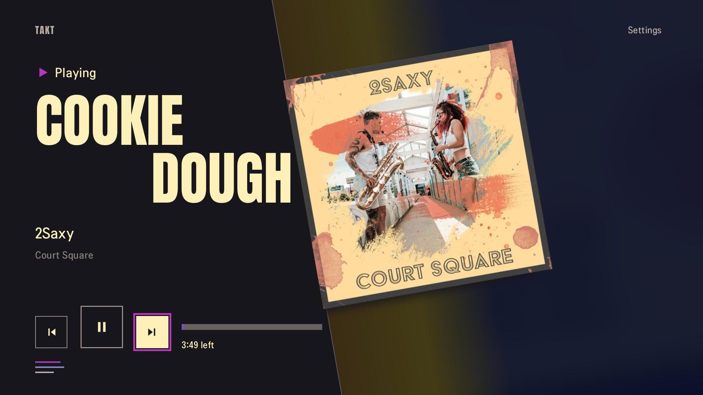

  

# Takt

A Music Assistant player for a rooted LG TV.

I built Takt because I wanted the TV in my living room to be a proper Music Assistant player — no
phone in the middle, no cast target, no browser tab that has to stay awake. Press play in Music
Assistant and the TV fills with album art and plays through its own speakers; the remote does pause,
skip and volume.

Takt is free-time work: one TV, one network, one person's evenings. There is no support and no
release schedule; issues are read, but nothing is promised. The Sendspin protocol is still a
technical preview, so expect rough edges.

## Why this exists

I built it in the evenings around 10–18 November 2026, mostly to have something to do while waiting
for Grand Theft Auto VI. The palette is still called _Leonida_ for that reason.

That is the whole connection: Takt is a fan project with no affiliation to Rockstar Games or
Take-Two and contains no GTA assets, fonts, logos or code. The homage stops at a name, a violet
night palette and the wait.

## Install

Takt is a Homebrew Channel app. Add this repository to the channel:

1. Open **Homebrew Channel → Settings → Repositories → Add repository**.
2. Paste `https://raw.githubusercontent.com/acuntex/takt/main/repo/apps.json` (the Channel loads the
   URL verbatim, so it has to be exactly this address).
3. Open the repository list and install **Takt**.

What you need: a rooted LG TV with webOS 4.x, the Homebrew Channel, and Music Assistant 2.10.x on
the same network. No computer, terminal, account or token.

The install never opens the app. On the first start Takt sets up its service; if the daemon does not
answer, the app offers a single reboot. Takt is also listed in the central
[`webosbrew/apps-repo`](https://github.com/webosbrew/apps-repo) once it has passed review there.

## First run

1. If Music Assistant asks whether to allow Takt, approve it. The settings live in
   `/media/internal/takt.json`, so the approval survives a reinstall; back that file up only before
   reflashing or resetting the TV.
2. Pick Takt as the player in Music Assistant and press play.
3. In **Settings** on the TV you can name the player. The TV page reads the boot PIN itself (the row
   is behind **Reveal**); you only type the PIN when writing from another machine.
4. That's it. The TV UI opens by itself when playback starts.

## Two things to set on the TV

- **Auto Power Off off.** The daemon holds a screensaver veto from service start, which keeps the
  panel awake, but the idle-to-standby path is the TV's own: without this setting it switches itself
  off mid-album.
- **Optional: TV audio delay.** If the TV feeds a soundbar or receiver over ARC/optical, group
  playback can be tens of milliseconds off. Press **Change** on that row and step in 10 ms while the
  other player runs until both line up. It applies live and is stored; larger values can be set in
  the config file.

## What it does

- Plays through the TV's speakers; the remote pauses, skips and changes the volume.
- Moves the cover with the bass and the kick, with a live spectrum band under it.
- Reports volume and mute changes back to Music Assistant, so both sliders agree.
- Pauses when you leave the app for another one; the Home overlay alone does not pause.
- Keeps the screensaver and the panel off while the daemon runs.
- Keeps several players in sync, with the audio delay row to trim the rest.
- Finds the server over mDNS if the configured address stops answering at the next start or
  connection rebuild.

The details — the volume guard, the PulseAudio curve, the leave rule, `output_delay_ms` — are in
[`docs/behaviour.md`](docs/behaviour.md).

## What may break

- **Takt does not show up in Music Assistant.** Approve it if asked. After renaming the player,
  restart the TV once so the service reloads.
- **The TV is silent.** In Live TV mode the tuner bypasses the PulseAudio sink, so Takt is inaudible
  there; other apps keep their own audio path.
- **The TV switches itself off.** See Auto Power Off above.
- **The first start shows “Takt needs one restart”.** Press **Reboot now**; after the reboot the
  daemon starts by itself.

## Learn more

- [`docs/install.md`](docs/install.md) — build, install, uninstall, manual steps
- [`docs/configuration.md`](docs/configuration.md) — `takt.json`, PIN, API, server discovery
- [`docs/behaviour.md`](docs/behaviour.md) — what happens during playback
- [`CONTRIBUTING.md`](CONTRIBUTING.md) — gates and commit conventions
- [`AGENTS.md`](AGENTS.md) — repository layout, the TV harnesses and the hard rules

## Credits and license

The Sendspin protocol is published by the Open Home Foundation. Takt is an unofficial client, not
affiliated with or endorsed by the Open Home Foundation, Music Assistant or LG. It builds on
[Music Assistant](https://www.music-assistant.io/), [GStreamer](https://gstreamer.freedesktop.org/)
and [PulseAudio](https://www.freedesktop.org/wiki/Software/PulseAudio/), and speaks
[Sendspin](https://github.com/Sendspin/spec) through the
[`syncspin`](https://github.com/acuntex/syncspin) client library.

The stage typeface is [Anton](https://fonts.google.com/specimen/Anton), Copyright 2020 The Anton
Project Authors, used under the SIL Open Font License 1.1; the licence ships in
[`web/fonts/OFL.txt`](web/fonts/OFL.txt).

MIT, see [`LICENSE`](LICENSE).
